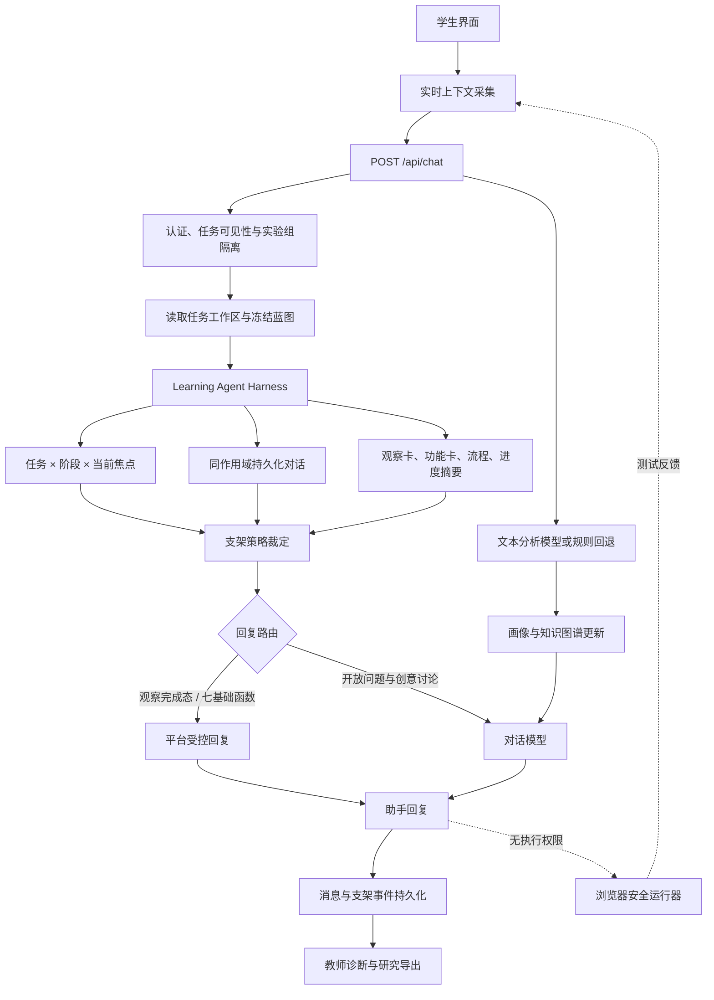

# CogniSync 教学智能体 Harness 架构说明

> - 文档状态：基于当前代码实现的技术说明与论文写作准备材料
> - 核对日期：2026-09-01
> - 适用分支：`codex/final-quasi-experiment-dev`
> - 核对基线：`c87591b` 及其之前已提交实现
> - 重要边界：本文档描述“系统已经实现什么”以及“未来可以怎样演进”，不构成学习效果已经得到验证的证据。

## 1. 核心结论

当前 CogniSync 可以被准确描述为一个 **面向项目式编程学习的教学智能体 Harness**，更完整的名称是：

> **阶段感知、策略约束、证据留痕的单教学智能体编排架构**
>
> *(a stage-aware, policy-constrained, and evidence-traceable learning-agent harness)*

它之所以属于 Harness，不是因为系统简单调用了大语言模型，而是因为模型外部已经形成一层稳定的编排基础设施，负责：

1. 确定学生当前所在的任务、学习阶段和功能焦点；
2. 从持久化数据中装配当前学习产物与同作用域对话记忆；
3. 在模型生成之前执行教师蓝图和 L0—L3 支架边界；
4. 决定本轮使用平台受控回复还是开放式模型回复；
5. 限制模型可见的数据和可执行权限；
6. 将学生求助、实际送达的支架、画像快照和代码指纹写入研究证据链。

因此，模型只是系统中的一个生成组件，**不是系统状态、教学权限或实验条件的最终控制者**。

但当前架构不是多智能体系统，也不是具有自主行动循环的通用 Agent。它没有自主规划器、工具注册中心、模型函数调用、文件或网络操作权限，也不会代替学生修改代码或推进学习阶段。

## 2. 本文对 Harness 的操作性定义

本文档不把 Harness 当作宽泛的宣传词，而采用下面的操作性定义：

> Harness 是位于用户界面、持久化状态、教学策略与大语言模型之间的编排层。它将一次不稳定的自然语言生成请求，转换为具有明确身份、上下文边界、权限边界、策略约束、可追踪输入输出和失败语义的系统回合。

按照这个定义，一个教学智能体 Harness 至少应回答六个问题：

| 问题 | CogniSync 当前实现 |
|---|---|
| 模型正在服务谁、哪个任务？ | 认证用户、研究任务和实验组权限由后端校验 |
| 学生当前在哪里？ | 前端提交当前阶段和焦点功能卡，Harness 建立稳定上下文键 |
| 模型本轮能看到什么？ | 同作用域历史、工作区摘要、当前代码、测试反馈、画像和教师目标 |
| 模型本轮允许给到什么程度？ | 教师蓝图与平台规则共同裁定 L0—L3实际等级 |
| 模型可以执行什么？ | 只能返回文本；不能操作文件、网络、数据库、编辑器或隐藏测试 |
| 这次支持如何被研究分析？ | 求助事件、消息、支架事件、等级、画像、代码指纹和蓝图版本被持久化 |

CogniSync 已经满足上述六项，因此称为 Harness 是有代码依据的。但论文中应使用限定语“教学智能体 Harness”或“学习智能体编排层”，不宜把它直接等同于通用 Agent Harness。

### 2.1 与 DeepSeek Harness 的关系

当前代码在工程思想上借鉴了三个 Harness 约束：每轮具有可序列化的作用域身份、模型历史从同作用域持久化消息中派生、当前 UI 上下文优先于旧对话推断。这三个约束已经明确写入 `learning_agent_harness.py`。

但当前项目**没有直接安装、分叉或集成名为 DeepSeek Harness 的外部运行库**。CogniSync 的 `LearningAgentHarness` 是结合自身教学流程实现的本地编排层，也没有引入外部框架可能包含的自主工具循环或通用任务执行能力。因此，后续论文最多可以在核验正式来源后说明“设计受到 Agent Harness 模式启发”，不能写成“系统基于 DeepSeek Harness 框架开发”，除非未来确实建立代码依赖并完成版本记录。

## 3. 设计目标与研究边界

### 3.1 设计目标

当前架构主要解决以下问题：

- **位置错判**：避免助手仅凭旧对话猜测学生所在环节或功能卡；
- **记忆串扰**：避免观察阶段、功能卡和不同基础函数之间混用历史消息；
- **支架越级**：避免模型自行从 L0跳到完整答案；
- **教师策略失效**：确保冻结蓝图的支架规则在回复生成前生效；
- **已完成任务重复追问**：根据持久化产物识别阶段完成状态；
- **研究证据失真**：区分“学生发起求助”和“支架成功送达”；
- **模型输出不可控**：对七个固定基础函数采用平台受控内容；
- **实验组污染**：阻止学生借任务 ID 读取其他实验组的支架策略。

### 3.2 当前不承担的目标

当前 Harness 不承担：

- 自主制定长期学习计划；
- 自主决定学生是否跳过或完成某一阶段；
- 自动创建、删除或修改学生产物；
- 自动编辑或运行学生代码；
- 多个模型 Agent 之间的协商和任务分工；
- 对学生内部心理状态作直接、确定性的判断；
- 证明系统已经提升学习成绩、迁移表现或人智协同能力。

## 4. 总体架构



这个架构的关键不是“有多少模型”，而是**谁控制状态、权限、回复深度和证据记录**。当前这些控制权位于服务端 Harness 与策略层，而不在大语言模型内部。

## 5. 一次教学回合的完整执行流程

### 5.1 前端形成实时学习上下文

学生打开助手或发送消息时，前端提交以下数据：

| 字段 | 含义 | 当前用途 |
|---|---|---|
| `taskId` | 当前研究任务 | 权限校验、工作区和蓝图定位 |
| `taskTitle` | 项目名称 | 上下文提示 |
| `stage` | 当前阶段 | 观察、拆功能、功能流程、再建构或迁移测试；保留旧 `plan` 阶段兼容 |
| `currentModule` | 当前功能焦点 | 建构/迁移阶段定位当前基础函数、创意函数或迁移函数卡 |
| `artifactSummary` | 浏览器实时产物摘要 | 补充尚未同步或当前正在编辑的状态 |
| `currentCode` | 当前编辑器代码 | 建构阶段理解学生实际代码 |
| `testFeedback` | 最近测试反馈 | 区分语法、行为或组合问题 |
| `level` | 请求支架等级 | L0—L3 |
| `trigger` | 求助触发方式 | 学生消息、提示按钮、升级或 L3确认 |
| `l3Confirmed` | 是否明确确认 L3 | 控制是否允许返回当前完整函数 |
| `requestId` | 本轮请求标识 | 前后端对齐和事件幂等 |

实现入口：[`frontend/components/ProjectScaffoldAssistant.tsx`](../frontend/components/ProjectScaffoldAssistant.tsx) 和 [`frontend/services/api.ts`](../frontend/services/api.ts)。

### 5.2 服务端先校验身份和实验条件

服务端不信任请求体中的 `userId` 或裸任务 ID，而以 JWT 当前用户为准，并校验该学生是否有权访问当前活动任务。该步骤同时承担实验组隔离：学生不能通过构造其他任务 ID 获取不同实验条件的蓝图策略。

实现位置：[`backend/app/api/endpoints/chat.py`](../backend/app/api/endpoints/chat.py) 中的 `_resolve_scaffold_task`。

迁移测试另外具有任务级 `ai_enabled` 权限。教师关闭 AI 时，前端不显示助手入口；后端仍会在写入学生消息、求助事件或支架证据之前拒绝伪造请求。因此该开关是 Harness 权限边界，而不是纯界面配置。

### 5.3 合并浏览器现场与数据库任务快照

后端读取该学生在指定任务中的 `workspace_data`，并将其压缩为事实摘要，内容包括：

- 已保存的观察卡；
- 功能卡名称、实现描述和引用观察；
- 每张功能卡的内部流程节点与连线摘要；
- 七函数建构进度与最近测试结果；
- 创意功能名称、事件钩子、测试和启用状态；
- 旧工作区中仍需兼容的实现路径数据。

浏览器实时摘要与数据库摘要合并后最多保留 6000 字符。学生产物被视为数据而不是 Prompt 指令，避免把学生填写的卡片标题当成模型命令。

实现位置：[`backend/app/services/scaffold_service.py`](../backend/app/services/scaffold_service.py) 中的 `summarize_project_workspace`。

### 5.4 Harness 建立上下文身份

每轮项目对话被绑定为：

```text
task:{task_id}|stage:{stage}|focus:{focus_id}
```

其中：

- 非建构阶段的 `focus_id` 等于阶段；
- 建构与迁移测试阶段的 `focus_id` 等于当前基础函数、创意函数或迁移函数卡 ID；
- 未选择函数时使用 `build-unselected`。

例如：

```text
task:a32bd811...|stage:build|focus:initial-state
task:a32bd811...|stage:build|focus:movement
task:a32bd811...|stage:observe|focus:observe
```

这个上下文键同时进入消息元数据和研究导出。其作用是把“学生现在在哪里”变成可序列化、可追踪且可以重新构建的状态，而不是依赖模型记忆。

实现位置：[`backend/app/services/learning_agent_harness.py`](../backend/app/services/learning_agent_harness.py)。

### 5.5 对话记忆严格按作用域投影

项目助手会从数据库读取较宽的最近 80 条持久化消息，然后只保留同一任务、同一阶段、同一功能焦点的最近 12 条作为模型历史。

这意味着：

- “初始化与重置”的历史不会进入“移动蛇身”；
- 观察阶段的坐标讨论不会进入建构阶段；
- 另一个研究任务中的对话不会进入当前任务；
- 项目助手不使用普通聊天的跨会话主题摘要；
- 普通自由聊天仍保持原有最近消息和跨会话主题逻辑。

当前记忆是**关系数据库中的作用域消息记忆**，不是向量数据库检索，也不是模型内部长期记忆。

### 5.6 支架策略在模型调用前裁定

服务端将学生请求等级、平台通用规则和冻结教师蓝图合并，得到实际生效等级：

```text
requestedLevel → policy resolution → appliedLevel
```

当前建构阶段的定义为：

| 等级 | 当前产品含义 |
|---|---|
| L0 | 只给测试、断言或打印代码定位问题，不补实现代码 |
| L1 | 给解决当前卡点所需的少量关键代码 |
| L2 | 给接近完整的当前函数结构，保留少量明确空位 |
| L3 | 一次明确确认后，给当前函数的完整正确实现 |

在学习建构阶段，L3只允许覆盖当前函数，不扩展到其他函数，也不会自动写入学生编辑器。如果学生请求 L3但没有确认，服务端将实际等级限制为 L2，并把 `requestedLevel`、`appliedLevel` 和 `wasClamped` 一并回传前端。首次确认后，该函数的 L3 作为持续协作权限保存：后续回合可直接引用、修改、补全和解释当前完整函数，不再退回 L0 式诊断，但仍无编辑器写入或代码执行权限。正式迁移测试采用第 19 节的独立实验条件：教师开启 AI 后从第一轮直接开放当前函数的 L3 协作。

学习者画像只能调整表达方式、步骤颗粒度和互动节奏，不能自动提高或降低支架等级。

实现位置：[`backend/app/services/scaffold_service.py`](../backend/app/services/scaffold_service.py) 中的 `resolve_scaffold_rule`、`build_profile_adaptation` 和 `build_scaffold_prompt`。

### 5.7 回复路由采用“受控生成 + 开放生成”混合模式

当前不是所有回答都交给大语言模型。

#### 路由 A：平台受控回复

下列情况优先使用服务端确定性回复：

- 观察阶段已完成，学生询问完成状态或下一步；
- 七个固定基础函数的 L0—L3支持；
- 学生询问助手当前读取的是哪张基础函数卡；
- 七个基础函数经过确认的 L3完整函数。

受控回复的意义是保证等级含义、函数契约和完成态判断不会因为模型随机性发生漂移。七函数 L3代码来自平台内置并经过行为检查的函数实现，而不是模型临时生成。

#### 路由 B：对话模型回复

未命中受控回复时，系统调用可配置的对话模型处理：

- 开放式解释和追问；
- 学生自己的功能命名与流程讨论；
- 创意函数方案讨论；
- 尚未被平台模板覆盖的项目和阶段问题。

即使走开放生成，模型仍受到当前作用域、L0—L3边界、教师目标、代码行数上限和画像表达规则约束。
当前焦点是创意函数时，Harness 还会向模型注入学生可见的安全运行器契约：七类 `event.type`、允许修改的顶层状态、`interval` 边界以及 `objects` 对象结构。它不接收教师隐藏测试，也不因此获得运行代码的工具权限；Python 仍由浏览器安全运行器在学生主动点击测试或运行后执行。

### 5.8 文本分析与回复生成是两个模型角色

系统把大语言模型用途分成两个可独立配置的角色：

| 角色 | 主要输出 | 特点 |
|---|---|---|
| `analysis` | 意图、情感、概念、画像增量 | 低温度、结构化 JSON；失败时规则回退 |
| `chat` | 面向学生的自然语言回复 | 较高温度；未命中受控回复时调用 |

两个角色可以配置为不同模型，也可以指向同一模型。它们是**同一条服务端流水线中的功能角色**，不是两个能够互相协商的 Agent，因此不能据此把系统描述为多智能体架构。

按钮生成的固定求助句不参与情感与画像分析，只有学生亲自输入的文本才会进入文本分析器，以免系统把界面模板误判为学生情绪证据。

实现位置：[`backend/app/services/llm_config.py`](../backend/app/services/llm_config.py)、[`backend/app/services/text_analyzer.py`](../backend/app/services/text_analyzer.py) 和 [`backend/app/services/llm_provider.py`](../backend/app/services/llm_provider.py)。

### 5.9 回复完成后形成研究证据

一次求助至少涉及两类不同事件：

1. `StageEvent(help_request)`：学生已经发起求助，即使后续模型超时，这个行为仍然成立；
2. `ScaffoldEvent(delivered)`：只有助手回复成功保存并实际送达后才记录。

`ScaffoldEvent` 保存：

- 任务、学生和请求 ID；
- 学生消息与助手消息关联；
- 当前阶段和触发方式；
- 请求等级、实际等级和是否被限制；
- 策略来源、最大代码行数和冻结蓝图版本；
- 当前功能模块；
- 当时的认知、情感和行为画像快照；
- 当前代码长度和代码指纹；
- 回复是否成功送达。

消息中的 `analysis.scaffoldContext` 继续双写，用于兼容既有教师页面与导出；规范研究数据逐步迁移到事件表。

实现位置：[`backend/app/models/sql/research_event.py`](../backend/app/models/sql/research_event.py) 和 [`backend/app/services/research_event_service.py`](../backend/app/services/research_event_service.py)。

## 6. 当前 Harness 的状态、记忆与权限模型

### 6.1 状态模型

当前状态由三部分组成：

| 状态来源 | 内容 | 权威性 |
|---|---|---|
| 浏览器实时状态 | 当前阶段、当前卡片、当前代码、当前测试反馈 | 本轮交互现场的权威输入 |
| 数据库任务快照 | 已保存观察卡、功能卡、流程、进度、创意功能 | 跨设备恢复与持久化事实 |
| 冻结教师蓝图 | 支架政策、函数契约、隐藏测试与实验条件 | 教学边界与实验条件的权威来源 |

模型不能自行修改三类状态，只能根据它们生成建议。

### 6.2 记忆模型

| 记忆类型 | 当前实现 | 是否进入模型 |
|---|---|---|
| 当前回合记忆 | 请求正文和实时上下文 | 是 |
| 作用域对话记忆 | 同任务、同阶段、同功能卡最近 12 条 | 是 |
| 任务产物记忆 | 数据库工作区的压缩摘要 | 是 |
| 学习者画像 | cognition、affect、behavior及表达适配 | 是 |
| 知识图谱 | 当前概念节点摘要 | 是 |
| 隐藏教师规则 | 由服务端执行 | 只提供边界，不下发隐藏文本 |
| 隐藏测试 | 由平台测试链路执行 | 否 |
| 模型内部长期记忆 | 未使用 | 否 |

### 6.3 权限模型

| 行为 | 当前 Agent 权限 |
|---|---|
| 读取当前阶段和卡片 | 允许 |
| 读取任务内已保存产物摘要 | 允许 |
| 读取当前代码和可见测试反馈 | 允许 |
| 给出文本建议或受控代码片段 | 允许，受 L0—L3约束 |
| 自动修改编辑器代码 | 不允许 |
| 自动运行代码 | 不允许 |
| 读取隐藏测试输入和标准答案 | 不允许 |
| 自动创建、删除或启用卡片 | 不允许 |
| 自动推进学习阶段 | 不允许 |
| 访问文件系统或公共网络 | 不允许 |
| 调用外部工具或函数 | 不允许 |
| 修改教师蓝图或实验条件 | 不允许 |

## 7. 安全、可控性与实验一致性设计

### 7.1 权限与实验组隔离

所有项目支架请求先验证认证用户、活动任务和可见范围。未经授权的任务不会静默退回普通对话，而是显式拒绝，避免产生无法归属实验条件的事件。

### 7.2 Prompt 注入边界

学生命名、观察卡和流程节点均被标记为数据，不视为指令；功能焦点标题经过单行化和长度限制。当前代码也只作为代码上下文，不授予执行权限。

### 7.3 隐藏教学资产保护

教师蓝图、函数契约、隐藏测试和平台 L3函数不直接下发到功能覆盖检查。Agent只接收或执行本轮必要边界。L3完整函数只有在学生明确确认后返回当前函数。

### 7.4 失败语义

- 文本分析模型失败时使用规则回退；
- 分析与对话调用有独立整轮超时和并发限制，有限重试只位于 provider 层；
- 服务端在等待外部模型前结束只读数据库事务，不用模型排队占用 PostgreSQL 连接；
- 模型最终失败时返回服务不可用，不伪造一条成功建议；
- 求助事件可以存在而支架送达事件不存在，从数据上反映真实失败；
- 图谱更新失败不会阻断主对话，但会记录日志。

### 7.5 数据最小化

- 前端当前代码最多提交约 10000 字符；
- 请求模式允许代码上限为 12000 字符；
- 实际注入对话 Prompt 的当前代码截取前 3000 字符；
- 合并后的阶段产物摘要最多 6000 字符；
- 模型历史限制为同作用域最近 12 条；
- 研究事件保存代码长度和指纹，不在支架事件中重复保存完整代码。

这些限制同时服务于延迟控制、Prompt 安全和研究数据最小化。

## 8. 为什么当前架构不是多智能体

系统虽然存在“分析”和“对话”两个模型角色，但不满足多智能体的关键特征：

- 两者没有独立目标和长期状态；
- 两者不会互相发送消息或协商；
- 没有任务分配器决定由哪个 Agent 接管问题；
- 没有 Agent 间共享工作空间；
- 没有多个候选方案的辩论、评价或汇总；
- 最终决策由服务端固定流程和规则完成。

因此应描述为：

> **具有双模型角色的单教学智能体流水线**，而不是多智能体系统。

如果未来增加“诊断 Agent—教学规划 Agent—安全评价 Agent”等相互独立且可追踪的角色，才适合讨论多智能体架构；但这会成为新的干预成分，需要单独评估，不能在当前准实验中无痕加入。

## 9. 为什么当前架构还不具有自主规划权限

当前系统能根据阶段和规则选择回复路线，但这种选择属于**确定性策略路由**，不等于 Agent 自主规划。

一个具有规划权限的 Agent 通常需要：

1. 根据目标形成多步计划；
2. 在步骤之间保存执行状态；
3. 选择和调用工具；
4. 根据工具结果修订计划；
5. 决定停止、重试或切换策略。

CogniSync 当前没有上述 `plan → act → observe → revise` 循环。学生每次求助都是一个由界面触发的单回合，Agent只返回文本，后续行动由学生完成。

从学校实验的安全性与可解释性考虑，未来更适合先增加**受限教学规划器**：规划器只能从教师定义的有限动作中推荐下一小步，服务端校验后展示给学生，仍由学生决定是否执行。规划权限不应扩展为自动修改代码、自动推进阶段或自动改变实验条件。

## 10. 当前实现的优势与局限

### 10.1 由代码支持的技术优势

- **阶段一致性**：实时 UI 阶段覆盖旧对话推断；
- **焦点一致性**：建构历史按当前函数隔离；
- **教学边界可执行**：L0—L3不是仅写在 Prompt 中，还由服务端规则裁定；
- **固定任务可重复**：七函数关键回复使用受控内容；
- **教师策略可追踪**：记录策略来源和冻结蓝图版本；
- **人保持行动权**：学生自行输入、复制、运行和确认；
- **研究过程可回溯**：求助、送达、画像和代码状态能够关联；
- **实验组隔离**：任务权限校验阻止跨组加载策略。

这些是架构性质和实现行为，不应直接改写为“提高了学习效果”或“增强了学生能力”。

### 10.2 当前技术局限

- 没有结构化教学计划对象，下一步仍主要表现为一轮文本建议；
- 除七函数和少量完成态外，开放问题仍可能受模型随机性影响；
- 工作区通过文本摘要进入模型，尚未采用完整的结构化产物检索；
- 记忆是最近消息过滤，不是基于学习目标或概念关系的语义检索；
- 当前功能焦点来自浏览器实时状态，服务器尚未用独立页面会话状态再次证明学生确实停留在该卡片；
- 完整聊天链路的事务级幂等仍未覆盖消息、模型调用、画像分析和事件的全部步骤；
- 模型配置可以由管理端更新，正式实验需要额外冻结并导出提供者、模型版本和 Prompt 版本；
- 学习者画像是系统根据对话和图谱形成的操作性指标，不等同于学生真实能力或真实情感；
- 当前实现还没有证明规划器、多智能体或个性化策略对学习结果的独立贡献。

### 10.3 学校实验需要特别控制的条件

正式实验前建议冻结并记录：

- 代码提交和部署版本；
- 教师蓝图版本；
- 实验组分配规则；
- 分析模型和对话模型的提供者、模型名称及版本；
- 完整系统 Prompt 与策略规则版本；
- 温度、最大输出长度、超时和重试参数；
- 前端阶段流程与 L0—L3定义；
- 浏览器运行器和测试契约版本；
- 研究期间发生的配置变更与故障窗口。

如果这些条件在实验期间改变，模型输出差异可能被错误解释为教学干预差异。

## 11. 论文写作中的术语与表述边界

### 11.1 推荐术语

| 中文 | 推荐英文 |
|---|---|
| 教学智能体 Harness | learning-agent harness / instructional agent harness |
| 学习智能体编排层 | learning-agent orchestration layer |
| 阶段感知 | stage-aware |
| 策略约束 | policy-constrained |
| 证据留痕 | evidence-traceable |
| 作用域对话记忆 | scope-bounded conversational memory |
| 受控支架回复 | controlled scaffold response |
| 支架策略裁定 | scaffold policy resolution |
| 人在回路 | human-in-the-loop |
| 人智协同调节 | human–AI co-regulation |

`Harness` 首次出现时应给出操作性定义，不要假设教育研究读者已经了解软件工程语境中的含义。

### 11.2 可以使用的表述

> 系统实现了一个教学智能体 Harness，用于在学生界面、任务产物、教师策略和大语言模型之间装配作用域上下文、限制支架深度并记录过程证据。

> 与直接把完整对话历史发送给模型不同，该架构依据任务、阶段和当前功能焦点构建作用域记忆，并以当前界面状态作为本轮权威学习情境。

> 在固定七函数任务中，平台将确定性支架内容与开放式模型生成相结合，以控制支架等级和完整答案的释放条件。

> 学生保留代码编辑、运行、阶段推进和 L3确认权，Agent只提供受约束的文本支持。

### 11.3 暂时不能使用的表述

在没有对应实验证据或实现前，不应写：

- “多智能体协作提高了学习效果”；
- “Agent能够自主规划学生的学习路径”；
- “系统准确识别了学生真实情绪”；
- “画像能够客观测量学生能力”；
- “Harness显著减少了认知负荷”；
- “分级支架提升了迁移能力”；
- “系统实现了通用自主智能体平台”；
- “该架构优于现有教学智能体”。

上述表述分别需要多智能体实现、规划日志、情感效度检验、测量模型、认知负荷数据、迁移测验或对照实验支持。

## 12. 可用于论文方法章节的中文初稿

### 12.1 系统架构概述

为避免大语言模型仅依据非结构化对话历史推测学生的学习状态，本研究在学生界面、项目学习产物、教师支架策略与模型服务之间构建了一个教学智能体 Harness。该 Harness 不直接赋予模型操作学习环境的权限，而是负责确定每轮交互的任务身份、学习阶段和当前功能焦点，装配与该作用域一致的对话记忆和项目产物，并在生成回复前执行教师设定的支架边界。由此，大语言模型被嵌入一个具有明确状态、权限和证据记录规则的教学流程，而不是作为脱离学习情境的独立聊天工具。

### 12.2 阶段感知与作用域记忆

每轮支架交互均由任务、阶段和当前焦点三个字段共同标识。非建构阶段以当前学习阶段作为焦点，建构阶段则进一步以学生正在编辑的基础函数或创意函数作为焦点。系统首先从持久化消息中读取较宽的近期窗口，再只保留与当前任务、阶段和功能焦点一致的对话记录。与此同时，系统将学生已保存的观察卡、功能卡、功能流程、函数测试和创意功能状态压缩为任务产物摘要。该设计使模型输入与学生当前操作界面保持一致，并减少不同学习阶段和功能卡之间的历史信息串扰。

### 12.3 教师策略约束与分级支架

学生可以按照 L0—L3请求不同程度的支持，但实际生效等级由服务端根据平台规则和学生首次开始任务时绑定的教师蓝图版本共同裁定。在建构阶段，L0用于通过测试、断言或打印定位问题，L1提供少量关键代码，L2提供接近完整的函数结构，L3则在学生完成一次明确确认后提供当前函数的完整实现。学习者画像可以调整语言的具体程度、步骤颗粒度和互动节奏，但不能改变支架等级或突破教师策略边界。系统同时向前端返回请求等级与实际等级，以避免学生感知到的支持强度与实际内容不一致。

迁移测试与学习阶段采用不同权限语义：所有学生从同一空白函数骨架开始；教师为该测试开启 AI 后，助手从第一轮就获得当前函数的 L3 完整代码协作权限，不再要求逐级解锁或二次确认。关闭 AI 的任务仍由后端在写入消息和研究事件前返回 403。这里测量的是不同支持条件下的人智协作迁移表现，而不是无工具条件下的独立编程能力。

### 12.4 受控回复与模型生成的混合机制

系统采用受控回复与开放式模型生成相结合的方式。对于观察阶段完成状态和七个固定基础函数，服务端优先返回与阶段和等级严格对应的受控内容；其中完整函数只在 L3确认后释放，且不会自动覆盖学生代码。对于学生的开放式解释请求、功能流程讨论和创意功能设计，系统在同一上下文与策略约束下调用对话模型生成回复。该混合机制的技术目标是降低固定教学任务中的输出漂移，同时保留开放项目讨论所需的自然语言生成能力。该目标属于系统设计动机，其对学习过程和学习结果的影响仍需通过后续实验检验。

### 12.5 个性化与过程证据记录

学生亲自输入的消息会经过独立的文本分析角色，形成意图、情感标签、概念和画像增量；界面按钮自动生成的固定文本不参与画像更新。画像信息用于调整回复表达而不是直接划分能力等级。系统分别记录学生发起求助的行为事件和支架成功送达事件，并保存请求等级、实际等级、策略来源、蓝图版本、当前功能、画像快照以及代码长度和指纹。这一设计为后续分析“求助—建议—修改—测试结果”之间的过程关系提供数据基础，但当前记录本身不能被视为支架有效性的证据。

### 12.6 人在回路的权限边界

Harness 不允许模型直接修改编辑器、运行代码、创建学习卡片或推进阶段。学生需要自行输入或复制代码、运行函数测试，并对是否请求 L3完整函数作出确认。教师则通过冻结蓝图控制函数契约、隐藏测试和支架策略。由此形成的权限结构将模型的作用限制为情境化建议生成，学生保留学习行动权，教师保留教学规则与评价边界。后续研究需要进一步检验这种人在回路的设计如何影响学生能动性、支架依赖和迁移表现。

## 13. 论文 Claim–Evidence 对照表

| 论文主张 | 当前证据 | 状态 |
|---|---|---|
| 系统实现了阶段感知的教学智能体 Harness | 上下文键、阶段字段、实时 UI 上下文和 Harness 代码 | 已实现，可写入方法 |
| 对话历史按任务、阶段和功能卡隔离 | `scope_history` 实现及后端单元测试 | 已实现，可写入方法 |
| 教师策略在回复生成前限制 L0—L3 | `resolve_scaffold_rule`、蓝图版本和响应元数据 | 已实现，可写入方法 |
| 七基础函数采用受控分级回复 | 受控回复表和 L3确认逻辑 | 已实现，可写入方法 |
| Agent读取学生现有观察卡和函数进度 | 工作区摘要与浏览器验收 | 已实现，可写入方法 |
| Agent不会自动修改或运行学生代码 | 当前权限模型和浏览器运行器边界 | 已实现，可写入方法 |
| 系统记录求助和支架送达 | `stage_events` 与 `scaffold_events` | 已实现，可写入方法 |
| Harness减少了重复追问 | 已有功能验收，只能证明特定案例修复 | 需要系统化过程指标后才能作为结果 |
| Harness改善了学习效果 | 尚无正式实验结果 | 不能写 |
| 个性化支架优于非个性化支架 | 尚无组间统计结果 | 不能写 |
| Harness会依据画像、知识图谱和冻结课程边界编译模板密度 | `prepare_learner_support`、消息元数据和单元测试 | 已实现机制，可写入方法；效果仍待验证 |
| 正式迁移测试从空白骨架开始且 AI 条件直接开放 | 教师任务 AI 开关、前后端 transfer 权限归一化 | 已实现条件控制，可写入方法 |
| 系统促进了人智协同调节 | 需要行为序列、访谈或量表支持 | 需要证据 |
| 系统提供可发布的迷宫寻宝迁移任务 | 教师发布、AI 权限、学生可视化运行器与函数建构台 | 已实现，可写入系统实现/方法 |
| 系统提升了迷宫寻宝迁移表现 | 正式迁移实验尚未进行 | 需要实验证据 |
| 当前系统是多智能体架构 | 不符合当前实现 | 不能写 |
| 当前 Agent具有自主规划权限 | 不符合当前实现 | 不能写 |

## 14. 后续文献支持需求

本文件的实现描述来自代码，不等同于理论或文献支持。论文中若要将架构与教育理论或智能体研究联系起来，至少需要另外检索和核验以下文献群：

1. 教学支架及支架渐隐；
2. 自我调节学习与人智协同调节；
3. 人在回路的教育智能体；
4. 大语言模型教学支持的可控性与越级帮助；
5. Agent Harness、上下文工程和作用域记忆；
6. 学习分析中的过程数据与可追溯证据链；
7. 课堂 AI 系统的数据治理、公平性与教师监督；
8. 情感计算标签的构念效度和误用风险。

在完成真实检索前，不应为上述理论关系补造作者、论文、DOI或研究结论。尤其需要区分：

- 文献已经明确提出的理论；
- 本研究据此作出的设计推论；
- CogniSync 已实现的技术机制；
- 正式实验才能验证的学习效果。

## 15. 未来演进建议

### 15.1 正式学校实验前

建议冻结当前单 Harness 架构，只进行安全、兼容、性能和可用性修复。不要在正式实验开始前无痕加入多智能体协商或自主执行权限，否则干预成分和输出随机性都会变化。

### 15.2 预测试阶段：影子教学规划器

可以增加一个不影响学生界面的“影子规划器”，生成结构化计划：

```json
{
  "current_stage": "build",
  "current_focus": "initial-state",
  "evidence": ["当前函数测试未通过", "存在语法错误"],
  "next_action": "先修复语法错误并重新运行",
  "requested_level": 0,
  "stop_condition": "获得新的测试反馈"
}
```

影子计划只进入教师诊断和研究日志，不直接改变学生界面。可先评估阶段判断正确率、重复建议率、教师认可度和计划与学生实际行动的一致性。

### 15.3 后续版本：受限规划权限

规划器成熟后，可从教师定义的有限动作集合中推荐下一步，例如运行测试、检查一个变量、返回修改功能卡或继续当前函数。所有计划必须经过服务端策略校验并由学生确认。Agent仍不得自动修改代码、推进阶段、改变等级或访问隐藏测试。

### 15.4 多智能体研究版本

只有当研究问题明确转向“不同智能体角色的协同是否改善教学支持”时，才建议建立诊断、规划、生成和评价等独立 Agent。届时应：

- 规定每个 Agent 的输入、输出、权限和失败语义；
- 记录 Agent 间消息和最终决策来源；
- 控制额外延迟、成本和随机性；
- 将多智能体作为显式实验变量；
- 与当前单 Harness 基线进行独立比较。

## 16. 实现索引

| 组件 | 文件 |
|---|---|
| 学生端助手与实时上下文 | [`frontend/components/ProjectScaffoldAssistant.tsx`](../frontend/components/ProjectScaffoldAssistant.tsx) |
| 聊天 API 封装 | [`frontend/services/api.ts`](../frontend/services/api.ts) |
| 请求与响应模式 | [`backend/app/schemas/chat.py`](../backend/app/schemas/chat.py) |
| 上下文键和作用域记忆 | [`backend/app/services/learning_agent_harness.py`](../backend/app/services/learning_agent_harness.py) |
| L0—L3、受控回复和工作区摘要 | [`backend/app/services/scaffold_service.py`](../backend/app/services/scaffold_service.py) |
| 对话主流程和权限校验 | [`backend/app/api/endpoints/chat.py`](../backend/app/api/endpoints/chat.py) |
| 模型角色配置 | [`backend/app/services/llm_config.py`](../backend/app/services/llm_config.py) |
| 统一模型接口 | [`backend/app/services/llm_provider.py`](../backend/app/services/llm_provider.py) |
| 文本分析 | [`backend/app/services/text_analyzer.py`](../backend/app/services/text_analyzer.py) |
| 学习者画像 | [`backend/app/services/profile_service.py`](../backend/app/services/profile_service.py) |
| 研究事件模型 | [`backend/app/models/sql/research_event.py`](../backend/app/models/sql/research_event.py) |
| 研究事件写入 | [`backend/app/services/research_event_service.py`](../backend/app/services/research_event_service.py) |
| Harness 和支架单元测试 | [`backend/tests/test_scaffold_service.py`](../backend/tests/test_scaffold_service.py) |
| 支架送达事件测试 | [`backend/tests/test_scaffold_event_delivery.py`](../backend/tests/test_scaffold_event_delivery.py) |
| 任务权限与实验组隔离测试 | [`backend/tests/test_research_task_guard_api.py`](../backend/tests/test_research_task_guard_api.py) |

## 17. 一句话版本

用于项目内部沟通：

> CogniSync 当前不是让大模型自由接管教学流程，而是用一个 Harness 把模型限制在当前任务、阶段、功能卡和教师支架政策中，并把每次求助与实际送达的建议记录为可追踪的研究证据。

用于论文方法概述：

> 本研究构建了一个阶段感知、策略约束且证据可追溯的教学智能体 Harness，通过作用域上下文装配、教师策略裁定和受控—生成式混合回复，将大语言模型嵌入项目式编程学习流程，同时保留学生的行动权与教师的规则控制权。

## 18. 2026-08-26 文档核对记录

- 已逐项对照前端上下文提交、聊天端点、Harness、支架策略、模型 Provider、文本分析和研究事件实现；
- 相关后端测试 `test_scaffold_service.py`、`test_scaffold_event_delivery.py` 和 `test_research_task_guard_api.py`：`63 passed`；
- 测试仍存在 4 条既有的 Pydantic `schema_json` 命名警告，与 Harness 架构和本文档无关；
- `git diff --check` 通过；
- 本轮只新增/修改项目内文档，没有修改论文、Obsidian 文件或运行时代码。

## 19. 2026-09-01 个性化可运行模板与正式迁移测试裁定

### 19.1 研究设计裁定

学习阶段与正式迁移测试必须分开解释：

- 学习阶段允许 Harness 根据当前画像、知识图谱证据和冻结课程边界调节模板颗粒度；
- 个性化只改变注释具体程度、可运行外围代码比例和 TODO 数量，不改变学习目标、阶段门槛或 L0—L3 权限；
- 正式迷宫迁移测试中，所有学生从相同空白骨架、相同运行器和相同任务说明开始；
- 教师开启 AI 的测试条件从第一轮直接开放完整代码讨论，不再逐级解锁；未开启 AI 的条件仍由后端禁止请求；
- 主要比较功能正确率、隐藏行为检查、代码组织和过程表现，完成时间只作为次要指标；
- “解构组思路更好”必须用功能分解、依赖顺序、针对性提问、基于证据的调试和 AI 建议审查等过程指标检验，不能只用速度推断。

因此，后续论文可以提出“解构学习可能促进开放 AI 环境中的结构化问题解决与人智协作”作为研究假设，但在正式数据分析前不能写成已验证结果。

### 19.2 当前实现的数据串联

本轮在现有单 Agent Harness 内增加确定性“学习者支架上下文编译器”，没有新增模型角色或第二次 API 调用：

```text
认证学生与任务
      │
      ├── 当前阶段 / 功能卡 / 代码 / 测试反馈
      ├── PostgreSQL 画像快照
      ├── Neo4j 概念掌握度 / 频次 / 学生标记
      ├── 首次任务绑定的冻结蓝图知识点与版本
      └── creative-v2 真实运行器能力契约
                         │
                         ▼
              Learner Support Compiler
              ├── guided：1—2 个小 TODO
              ├── balanced：2—3 个聚焦 TODO
              └── open：保留更大的关键逻辑空间
                         │
                         ▼
              同一次 DeepSeek chat 请求
                         │
                         ▼
         可运行函数骨架 / 完整函数讨论 / 明确能力缺口
```

知识图谱节点只在与当前冻结课程概念相关时进入支架计划；无关概念不会为了“个性化”被带入当前任务。模板必须在 TODO 未完成时仍语法正确、可以运行，并且只能使用真实事件、状态字段与帮助函数。支架计划随本轮消息元数据保存 `contextVersion`、模板密度、蓝图版本、课程概念和实际采用的图谱证据，便于教师和研究导出复建。

### 19.3 教材边界

仓库目前没有教师批准并发布的正式教材文件，也没有教材上传、版本冻结和片段检索链路。因此当前实现使用两层边界：

1. 冻结教师蓝图中的知识点，例如变量与状态、列表、二维坐标、条件判断、循环、成员判断、布尔表达式、函数组合与时间间隔；
2. 教师任务中的教学目标文本。

系统会明确记录 `textbookRetrievalEnabled=false`，不得在界面或论文中把当前实现描述成教材 RAG。正式教材接入后必须保存教材版本、章节、片段 ID 和发布时间，并在实验开始后冻结；教材只能约束解释和模板，不能覆盖运行器能力契约。

### 19.4 开源架构参考与取舍

本轮只吸收架构模式，不引入外部运行时依赖：

- [DeepSeek Harness architecture](https://github.com/deepseek-ai/deepseek-harness/blob/master/docs/architecture.md)：采用“模型可见输入必须可从持久事实重建”、Prompt section 装配、能力 seam 与持久事件/运行中事件分离的思想；CogniSync 保留自己的教学领域实现，不接入其插件树和工具循环。
- [LangGraph persistence](https://github.com/langchain-ai/docs/blob/main/src/oss/langgraph/persistence.mdx)：参考线程内检查点与跨线程长期数据分离；CogniSync 已分别使用作用域消息、任务快照和画像/图谱，不为当前短流水线增加图运行时。
- [PydanticAI structured output](https://github.com/pydantic/pydantic-ai/blob/main/docs/output.md)：后续结构化创意提案应先经 Schema 验证再展示；本轮仍输出学生可读文本，不把未经验证的模型 JSON 直接装配进运行器。
- [OpenAI Agents SDK](https://github.com/openai/openai-agents-python)：参考 guardrail、session 与 trace 的职责分离；CogniSync 当前没有模型工具调用或 handoff，不为“看起来像 Agent”而引入多智能体依赖。

这一取舍符合当前 40—50 人课堂和小服务器约束：创新点放在“教学证据如何被编译为可追溯的个性化支架”，而不是 Agent 数量。

### 19.5 基础设施参数

当前 Python 代码和游戏绘制都在学生浏览器的 Worker/Canvas 中运行，服务器主要承担鉴权、关键版本/事件存储、画像/图谱查询和 DeepSeek API 编排。2026-09-01 本地空闲容器观测约为：后端 114 MiB、PostgreSQL 40 MiB、Neo4j 856 MiB、三个 Nginx 容器合计约 15 MiB；这不是课堂压测结果。

建议参数：

| 场景 | CPU | 内存 | 磁盘 | 说明 |
|---|---:|---:|---:|---|
| 本地演示/少量预测试 | 2 vCPU | 4 GB | 40 GB SSD | 可运行，但 Neo4j 与系统余量较窄 |
| 40—50 人正式课堂推荐 | 4 vCPU | 8 GB | 80 GB SSD | 单后端实例、外部 DeepSeek API、保留监控与峰值余量 |
| 只有 4 GB 可用时 | 4 vCPU | 4 GB + 2 GB swap | 60 GB SSD | Neo4j heap 调低至 256—512 MB，LLM 总并发先限 6—8，必须预测试 |

网络建议至少 20 Mbps 稳定上行，优先 100 Mbps 端口；Pyodide 静态资源应由 Nginx 自托管并设置长缓存。正式配置不能只凭上述估算，需用目标 DeepSeek 账号完成 50 个独立学生的冷启动、集中求助和故障退避压测，记录 P50/P95、429、超时、队列长度和数据库连接占用。

### 19.6 明确未实现

- 教师教材上传、版本化发布与检索；
- DeepSeek analysis/chat 的单进程共享公平队列；
- 全链路 requestId 幂等状态机；
- 自动把 Agent 模板写入编辑器；学生仍需自行复制、修改和运行；
- 多智能体协商、自主规划和自动执行学生代码。

这些能力不应写成当前系统事实。学校实验前优先完成共享并发预算、请求指标和教材冻结链路，不建议增加多智能体。
